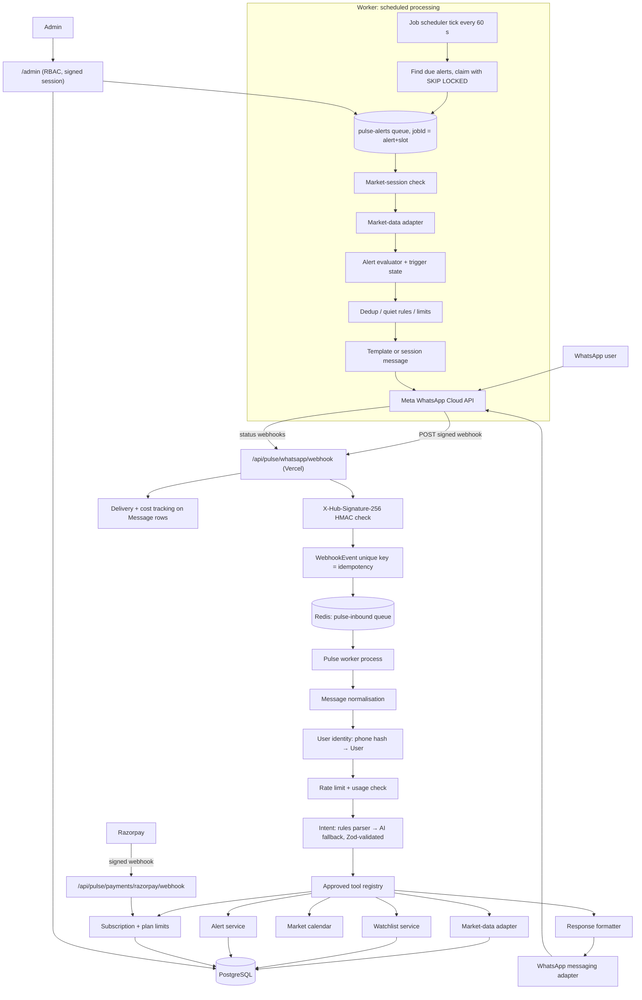

# Adritash Pulse — Architecture

Status: implemented as described (see `BUILD_STATUS.md` for what is verified).

## 1. Repository assessment (2026-11-22)

| Area | Finding | Decision for Pulse |
|---|---|---|
| App | `website/` is a Next.js 16.2 App Router app, React 19.2, TypeScript strict, Tailwind v4, `@/` → `src/`. Deployed on Vercel from `main` (push to `main` redeploys adritash.com). | Pulse lives **inside the same app** as an isolated namespace (`src/pulse/**`, `src/app/pulse/**`, `src/app/admin/**`, `src/app/api/pulse/**`, `src/app/api/health/**`). No existing file is rewritten. |
| Routes | Marketing pages, `/dashboards/*` (PM toolkit, RAID generator), `/api/ai/chat` (Gemini chat widget), `/api/contact` (Resend), `/api/pm/raid/generate`. | Untouched. Pulse adds new routes only. |
| Proxy | `proxy.ts` (Next 16 replacement for middleware) sets nonce CSP + security headers on non-API routes. | Pulse pages inherit it. Pulse API routes are excluded by its matcher and set their own headers. |
| Auth | None. Clerk keys exist in `.env.local` but Clerk is not installed or used. | Pulse adds its own minimal auth: WhatsApp-number identity for end users (single-use magic link into the dashboard) and DB-backed admin accounts with scrypt hashes, signed session cookies and roles. Not Clerk, to avoid a new paid dependency and a site-wide middleware change. |
| Database | None. | PostgreSQL via Prisma 7 (`prisma-client` generator + `@prisma/adapter-pg`), migrations in `prisma/migrations`. |
| Queue / cache | `src/lib/rate-limit.ts` optionally uses Upstash REST, else in-memory. | Redis + BullMQ for durable jobs; Pulse rate limits use the same Redis. Existing rate limiter untouched. |
| AI | `@google/genai` with `gemini-3.6-flash` (`src/lib/ai`). | Pulse reuses the SDK and key behind its own `IntentInterpreter` interface, with a deterministic rules parser first so most messages cost ₹0 in AI. |
| Branding | Official files in `public/logo/` (`adritash-logo.jpg`, `adritash-emblem.png`, `adritash-lockup-v3.png`), palette tokens in `src/styles/globals.css` (teal-black ink, champagne, gold/bronze). | Pulse UI uses these exact files and tokens. No redrawn logo. |
| Tests | Playwright smoke tests in `tests/smoke.spec.ts`. No unit runner. | Add Vitest for Pulse unit/integration/e2e (`tests/pulse/**/*.test.ts`); Playwright restricted to `*.spec.ts` so the two never collide. |
| Hosting | Vercel (serverless). | Vercel keeps the web app + webhooks. A **separate persistent worker** runs the scheduler and queues (Vercel cannot run long-lived workers). |

## 2. Logical architecture



## 3. Module layout (as built)

```
src/pulse/
  config/            env parsing (Zod), plan defaults, cost rates, feature flags
  infrastructure/    db (Prisma client), redis, queue (BullMQ), logger, crypto
  lib/               errors, ids, phone utils, money, time (IST)
  modules/
    whatsapp/        client (Graph API), webhook parsing + signature, templates, sender (window/template choice, cost)
    conversations/   inbound pipeline, conversation context (pending clarification/consent)
    ai/              intent schema (Zod), rules parser, Gemini interpreter, tool registry, prompt
    market-data/     provider interface, quote validation, cache, providers/{eodhd, sandbox}, symbol resolution
    market-calendar/ trading-day + session logic backed by MarketHoliday table
    watchlists/      service + repository (all queries scoped by userId)
    alerts/          service, evaluator, schedule calculator, scheduler, executor
    subscriptions/   plans, limits, usage
    payments/        provider interface, Razorpay adapter, webhook handler
    users/           identity resolution, consent, deletion
    admin/           admin auth, metrics queries
    audit/           audit log + security events
  workers/           main.ts (one process, three BullMQ workers: inbound, alerts, maintenance) + processors.ts
src/app/pulse/       public product page, privacy, terms, user dashboard
src/app/admin/       protected admin dashboard
src/app/api/pulse/   whatsapp webhook, payment webhook, dashboard/admin actions
src/app/api/health/  /api/health, /ready, /live
prisma/              schema.prisma, migrations, seed
tests/pulse/         unit, integration, e2e (Vitest)
```

## 4. Key flows

**Inbound message.** Meta POSTs to the webhook. The route reads the raw body, verifies `X-Hub-Signature-256` (HMAC-SHA256 with the app secret, constant-time compare), validates the payload with Zod, and for each message/status inserts a `WebhookEvent` keyed by `(provider, providerEventId)`. New events are pushed to `pulse-inbound` with `jobId = providerEventId`, then the route returns 200. Duplicates are acknowledged without work. If Redis is down the route returns 503 so Meta redelivers, and the event row is retried. The worker resolves the user by phone HMAC, records the inbound message, applies per-user rate limits, interprets the intent, runs exactly one approved tool, formats the reply and sends it.

**Intent and tools.** The deterministic rules parser handles common phrasings. Only if it returns UNKNOWN or low confidence does the AI interpreter run (Gemini, JSON schema output). Either result is validated by the same Zod schema. The model returns a *company/stock phrase*, never a trusted symbol, and never prices or times. Symbol resolution is done against the `Instrument` table; ambiguity triggers a numbered clarification stored in conversation context. Tools receive `userId` from the resolved identity, never from model output, so a prompt cannot reach another user's data.

**Recurring alert.** Creating one records a `ConsentRecord` (type `RECURRING_UPDATES`, text version) and `Alert.consentAt`, validates the frequency against the plan, and computes `nextRunAt` with the market calendar (next valid in-session slot). Every 60 s the scheduler claims due alerts (`FOR UPDATE SKIP LOCKED`), writes an `AlertExecution` row with a unique `(alertId, scheduledFor)`, advances `nextRunAt`, and enqueues a job with the same idempotency key. The executor re-checks status, consent, plan and session, fetches the quote, evaluates, and sends. The outbound `Message` row is inserted with a unique idempotency key before the API call, so a retry never double-sends.

**Holiday.** If the slot is not a trading session for that exchange, the scheduler skips to the next session open slot and records a `SKIPPED_MARKET_CLOSED` execution. If the calendar for that year is not loaded, nothing is sent (`SKIPPED_CALENDAR_UNAVAILABLE`) and an ops alert fires: fail safe, not Monday-to-Friday guessing.

**Price alert.** `PRICE_ABOVE`/`PRICE_BELOW`/`PERCENT_MOVE` alerts are evaluated every 15 minutes during session. They carry `triggerState` (`ARMED`/`TRIGGERED`). Triggering sends once and moves to `TRIGGERED`. It re-arms only after the price crosses back past a hysteresis band (default 0.5%).

**Delivery.** Status webhooks (`sent`, `delivered`, `read`, `failed`) update the `Message` row by `providerMessageId`, including Meta's `pricing.category` and billable flag, which feeds cost tracking.

## 5. Security boundaries

1. Public edge: only the webhooks, health, public pages and magic-link login are reachable without a session. Webhooks require valid HMAC signatures.
2. User boundary: every repository function takes `userId` and filters by it; cross-user access attempts return "not found" and write a `SECURITY` audit event.
3. AI boundary: model output is data. It can only select one of the registered intents with validated fields; it never sees other users' data, secrets or the DB.
4. Admin boundary: `/admin` requires a signed, HTTP-only, SameSite=Strict session cookie from a DB admin account; roles `OWNER`, `OPERATOR`, `VIEWER` gate actions. Phone numbers are masked in all admin views.
5. Secrets: env only (`.env.example` lists them), validated at startup, never in `NEXT_PUBLIC_*`. Logs pass through a redactor for phone numbers, tokens and signatures.
6. Data at rest: phone numbers are stored as HMAC hash (lookup) + AES-256-GCM ciphertext (for sending). Message bodies are purged after the retention window (default 30 days).

## 6. Deployment shape

```
adritash.com (Vercel)            Worker host (Railway / Render / Fly)
  Next.js pages + API routes  ─┐   node dist worker (BullMQ workers + scheduler)
  WhatsApp + Razorpay webhooks │
                               ├── Managed PostgreSQL (Neon / Supabase / Railway)
                               └── Managed Redis (Railway / Render Key Value / Upstash fixed plan)
```

See `docs/pulse/deployment.md` for the step-by-step.
